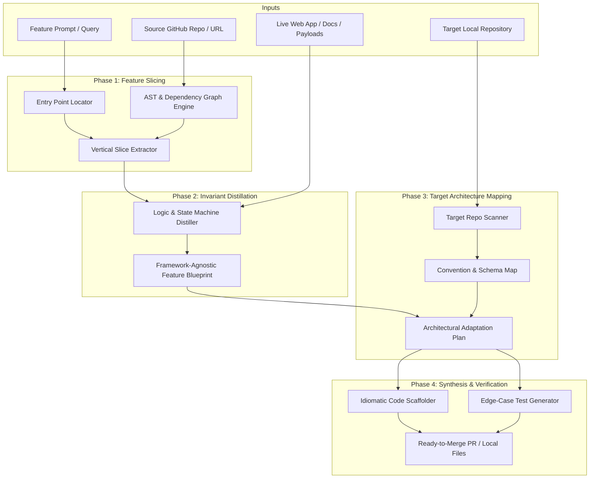

# FeatureForge (RepoTransposer) — Project Guide & Memory for Claude Code

## 1. Executive Summary & Vision

### What FeatureForge Is
**FeatureForge** (internal repo name: `ai_redemption`) is an **agentic feature reverse-engineering and architectural transposition engine**. 

Instead of being another shallow *"Chat with your GitHub repo"* or naive RAG search tool that outputs disjointed snippets, FeatureForge solves the **Software Transposition Problem**:
> Elite software development relies on reference implementations (e.g., how Linear implements sync, how Cal.com computes availability, or how Supabase handles auth triggers). Manually extracting a feature from a 50,000-line monolith takes days of code archaeology. FeatureForge extracts that feature's vertical slice, distills its logic and invariants into a framework-agnostic blueprint, and transposes (scaffolds) it cleanly into a target project.

### Differentiation: REA vs. FeatureForge
* **REA (`morluto/rea`)**: Solves the *binary black-box problem* (reverse-engineering compiled `.exe`/ELF binaries using Ghidra/IDA for malware analysis and security research).
* **FeatureForge**: Solves the *software architecture transposition problem* (extracting clean design patterns from open-source repositories and transposing them into idiomatic target codebases).

---

## 2. The 4-Phase System Pipeline (Roadmap)



1. **Phase 1: Deterministic Feature Slicing**
   - Locates entry points (routes, CLI commands, UI event handlers) via AST parsing and semantic search.
   - Traces call graphs, data models, and queries to isolate a minimal vertical slice (~500–1,500 LOC), filtering out irrelevant monolithic baggage (billing, unrelated auth, CSS).
2. **Phase 2: Invariant Distillation (Framework-Agnostic Blueprint)**
   - Extracts schemas (I/O contracts), pure algorithms, state machines, and edge-case invariants (gleaned from source tests).
3. **Phase 3: Target Architecture Alignment**
   - Scans the target project (e.g., `ai_redemption`), learns its patterns (Clean Architecture, ORM conventions, naming, typing, error handling), and creates an adaptation recipe.
4. **Phase 4: Idiomatic Synthesis & Verification**
   - Scaffolds files directly into target modules (`entities/`, `repositories/`, `services/`, `schemas/`), ports tests, and verifies syntax/type soundness.

---

## 3. Current Implementation Status (The Engine Built So Far)

The foundational intelligence and runtime infrastructure is complete. We have built an enterprise-grade **Context Engineering, Compaction & Hierarchical Memory Engine** that powers long-running agent interactions and feature transposition tasks without context degradation.

### Core Architectural Accomplishments:
* **Strict Clean Architecture:** Separation across Entities $\rightarrow$ Repositories $\rightarrow$ Schemas $\rightarrow$ Services $\rightarrow$ Inference.
* **4-Tier Context & Hierarchical Memory Hierarchy:**
  1. **Tier 1 (Base Instructions):** System prompt defining the agent role.
  2. **Tier 2 (User Profile Memory):** Persistent cross-session user preferences (`<user_profile>`, budgeted to ~150 tokens).
  3. **Tier 3 (Project Workspace Memory):** Persistent cross-session project architectural rules & decisions (`<project_memory>`, budgeted to ~350 tokens).
  4. **Tier 4 (Session Compaction Summary):** Versioned, structured operational ledger (`<session_summary>`) tracking primary goals, key decisions, constraints, and artifacts.
  5. **Working Memory (Sliding Window):** Atomic conversational turns `[user, assistant]` packed dynamically up to the token budget.
* **Predictable Token Budgeting Equation:**
  $$\text{Input Budget } (I) = \text{Context Limit } (C) - \text{Reserved Output } (O) - \text{Safety Margin } (S)$$
  *(e.g., $8192 - 1500 - 200 = 6492$ tokens).*
* **Incremental Watermarking & Compaction:**
  - Auto-compaction triggers at 80% buffer capacity (`auto_compact_threshold`).
  - Supports manual `/compact` slash command.
  - Zero-duplication watermark tracking via `last_covered_sequence_number`.
  - **Anti-thrashing & Active-turn preservation:** Excludes the current in-flight user message from compaction so it remains in working memory without truncation.
* **Dual-Pass Extraction:**
  - `Compactor`: Compresses conversational turns into an operational summary ledger using LangChain structured outputs.
  - `MemoryExtractor`: Extracts durable cross-session facts into PostgreSQL (`user_memories` and `project_memories`).
* **Persistence Layer:**
  - PostgreSQL (Neon serverless) with SQLAlchemy 2.0 type-annotated models, Alembic migrations, and UUIDv7 primary keys.

---

## 4. Codebase Directory Layout & Responsibilities

```
/Users/adityadebnath/Projects/ai_redemption/
├── alembic/                       # Database schema migrations
├── app/
│   ├── config.py                  # Dataclass Settings (Ollama, context limits, Neon DB URL)
│   ├── database.py                # SQLAlchemy engine & session maker
│   ├── entities/                  # SQLAlchemy ORM declarative models (pure domain)
│   │   ├── base.py                # Base declarative class
│   │   ├── user.py                # User entity (UUIDv7 PK)
│   │   ├── project.py             # Project workspace entity
│   │   ├── user_memory.py         # Cross-session user preferences/facts
│   │   ├── project_memory.py      # Cross-session project architecture/facts
│   │   ├── conversation.py        # Conversation session entity
│   │   ├── message.py             # Message entity (scoped sequence_number)
│   │   └── conversation_summary.py# Versioned compaction summary entity
│   ├── repositories/              # Data persistence abstraction
│   │   ├── interfaces.py          # Abstract protocols (UserRepository, MemoryRepository, etc.)
│   │   ├── in_memory.py           # In-memory mock repositories for ultra-fast testing
│   │   ├── postgres_user.py       # PostgreSQL user persistence
│   │   ├── postgres_project.py    # PostgreSQL project workspace persistence
│   │   ├── postgres_memory.py     # PostgreSQL hierarchical memory persistence
│   │   └── postgres_conversation.py # PostgreSQL conversation, message & summary persistence
│   ├── schemas/                   # Pydantic v2 DTOs & structured output schemas
│   │   ├── chat.py                # ChatRequest, ChatResponse
│   │   ├── context.py             # ContextPackage, Turn models
│   │   ├── memory.py              # UserProfileDTO, ProjectMemoryDTO, ExtractedMemoryPackage
│   │   ├── project.py             # Project DTOs
│   │   └── summary.py             # CompactionSummary & CompactionResult
│   ├── services/                  # Pure business logic (NO raw SQL, NO DB sessions)
│   │   ├── conversation_service.py# Orchestrates chat, compaction, memory retrieval & inference
│   │   ├── context_manager.py     # Multi-tier context assembling & token budget enforcement
│   │   ├── compactor.py           # LangChain LLM compactor with structured outputs
│   │   ├── memory_extractor.py    # Structured extraction of durable user/project facts
│   │   ├── memory_service.py      # Budget-packing and retrieval of Tier 2 & Tier 3 memories
│   │   ├── token_counter.py       # tiktoken BPE token counter
│   │   └── user_service.py        # User registration and verification
│   ├── inference/                 # LLM inference adapters
│   │   ├── base.py                # Abstract InferenceClient protocol
│   │   └── ollama_client.py       # Ollama / OpenAI-compatible API client (Qwen 2.5)
│   ├── exceptions/                # Domain-specific exceptions (e.g. UserNotFoundError)
│   └── test/                      # Phased test suites (test_phase2 through test_phase5)
├── assistant.py                   # Lightweight terminal CLI loop
├── AGENTS.md                      # Project memory & architectural guidelines for agents
├── CLAUDE.md                      # Project briefing and instructions for Claude Code
└── PROJECT_VISION.md              # Long-term vision and feature transposition manifesto
```

---

## 5. Non-Negotiable Engineering Rules & Conventions

When Claude Code operates on this repo, it must adhere to these established patterns:

1. **Clean Architecture Separation:**
   - Services (`app/services/`) **must never** import SQLAlchemy sessions, execute queries, or make direct DB calls. All persistence must go through abstract repository interfaces (`app/repositories/interfaces.py`).
2. **Deterministic Token Accounting:**
   - All prompt construction must pass through `TokenCounter` and `ContextManager`. Never append raw strings into LLM prompts without budget validation.
3. **Structured Outputs Over String Parsing:**
   - Any LLM extraction (summaries, memories, future AST blueprints) must use LangChain's `.with_structured_output(PydanticModel)` or strict Pydantic schemas.
4. **Data Integrity & Watermarking:**
   - Messages are ordered by strictly increasing `sequence_number` per `conversation_id`.
   - Compaction summaries are immutable and versioned (`version` column), with strict `last_covered_sequence_number` tracking.
   - Deletions cascade cleanly: `User` $\rightarrow$ `Conversation` $\rightarrow$ `Message` / `ConversationSummary`.
5. **Testing Patterns:**
   - Unit tests use `InMemoryConversationRepository` and `MockInferenceClient` to execute deterministically in milliseconds without external network/Ollama dependencies.
