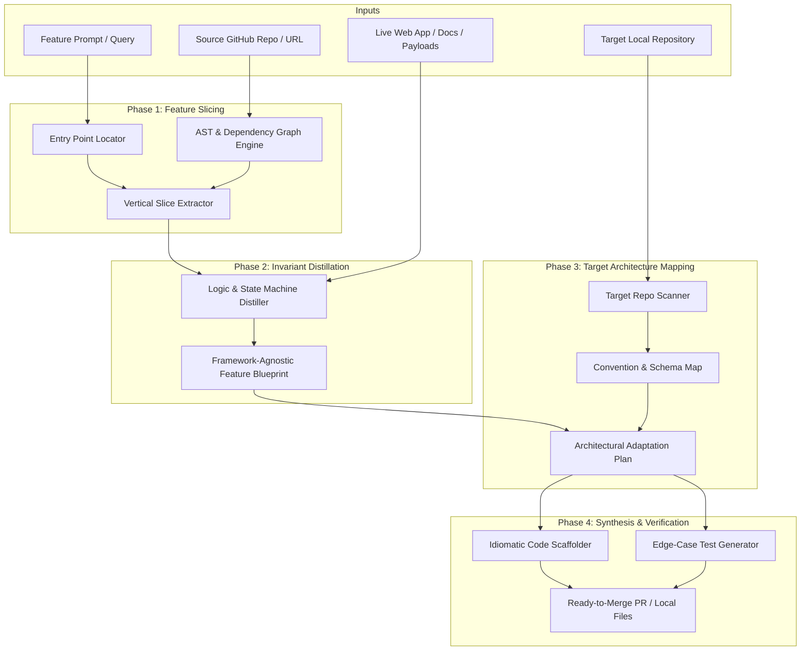

# FeatureForge (RepoTransposer)
## Agentic Feature Reverse-Engineering & Transposition Engine

---

## 1. Executive Summary & Vision

### 1.1 The Core Problem
The developer tooling market is saturated with shallow **"Chat with your GitHub repo"** chatbots. These tools treat codebases as passive text collections, run naive RAG over fragmented file chunks, and output generic, disconnected code snippets.

In the real world, **software development is driven by reference implementations**. When engineers build high-scale, production-ready features, they study how elite open-source projects solved the problem (e.g., how Linear implements offline sync, how Supabase manages auth triggers, or how Cal.com computes availability slots).

However, manually extracting a feature from a 50,000-line open-source monolith takes days of code archaeology:
- Tracing dependencies scattered across dozens of files and packages.
- Untangling core business logic from framework-specific boilerplate and legacy baggage.
- Manually rewriting the pattern to fit their own project's architecture, language, database, and conventions.

### 1.2 The Solution
**FeatureForge** is an agentic system that transforms open-source repositories and live web products into modular, adaptable features for your own codebase.

Instead of generic chat, FeatureForge performs:
1. **Vertical Feature Slicing:** Deterministically identifies and extracts only the relevant call graphs, data models, and business logic.
2. **Logic & Invariant Distillation:** Strips out framework noise and captures the pure state machines, algorithms, and edge cases.
3. **Architectural Transposition:** Rewrites and scaffolds the feature directly into the target project using the target's existing architecture, schemas, and conventions.

### 1.3 The Core Transposition Formula
FeatureForge is laser-focused **exclusively on Python backend systems** (Clean Architecture, SQLAlchemy, Pydantic, Alembic). Frontend code is deliberately out of scope.

Transposition is NOT file migration or copy-pasting. It is semantic reverse-engineering:
$$\text{Reference Feature Logic} + \text{Target Codebase Architecture \& Contracts} = \text{Clean, Production Target Code}$$

---

## 2. Positioning & Market Differentiation

### 2.1 The Spectrum of AI Reverse Engineering

```
┌─────────────────────────────────┐       ┌─────────────────────────────────┐
│     REA (morluto/rea)           │       │    FeatureForge (This Project)  │
├─────────────────────────────────┤       ├─────────────────────────────────┤
│ Target: Closed Binaries (.exe)  │       │ Target: Open-Source Code + Web  │
│ Tooling: Ghidra, IDA Pro, Hopper│       │ Tooling: ASTs, Call-Graphs, LLM│
│ Focus: Malware, Forensics, Cracking     Focus: Architecture & Development │
│ Output: Decompiled Pseudo-C     │       │ Output: Idiomatic Target Code   │
└─────────────────────────────────┘       └─────────────────────────────────┘
```

* **REA (`morluto/rea`):** Solves the *Black-Box Problem* (turning compiled binaries back into readable code for security researchers).
* **FeatureForge:** Solves the *Software Transposition Problem* (extracting clean design patterns from open-source repositories and seamlessly implementing them into your project).

---

## 3. System Architecture & The 4-Phase Pipeline



### 3.1 Source Repository Ingestion & In-Memory Tarball Architecture
FeatureForge supports three frictionless user entry points for reference repositories:
1. **Public GitHub URL:** `https://github.com/owner/repo`
2. **Local Folder Path:** `path/to/local/reference_repo`
3. **Curated Feature Catalog:** Pre-indexed, popular implementations (e.g., "FastAPI JWT Auth").

#### Zero-Git HTTP Tarball Streaming
To eliminate terminal credential hangs and Git CLI dependencies, remote GitHub repositories are ingested using direct archive streams:
`https://codeload.github.com/{owner}/{repo}/tar.gz/refs/heads/{branch}`
- **Sub-2-Second Ingestion:** Streams and decompresses directly into `~/.featureforge/cache/sources/{owner}_{repo}_{branch}/` in seconds.
- **Zero Git CLI Dependency:** Pure Python `httpx` and `tarfile` streaming.
- **Surgical Feature Isolation:** Phase 6 extracts only the required `VerticalSlice` (e.g. 7 symbols, 121 LOC), and the rest of the 50,000-line repository is set aside.

### Phase 1: Deterministic Feature Slicing
* Locates entry points (HTTP routes, CLI commands, UI handlers) using semantic search and AST queries.
* Traces call hierarchies, type definitions, and database queries.
* Isolates the minimal viable vertical slice (~500–1500 lines of code), ignoring unrelated monolith baggage (billing, auth, styling).

### Phase 2: Invariant Distillation (Framework-Agnostic Blueprint)
* Translates the vertical slice into an intermediate representation:
  - **Inputs & Outputs:** Exact schema contracts.
  - **State Machine:** States, transition triggers, and invariants.
  - **Core Algorithms:** Business logic stripped of framework dependencies.
  - **Edge Cases:** Extracted from the source repository's test suites.

### Phase 3: Target Architecture Alignment
* Analyzes the target codebase (`ai_redemption`):
  - Detects architectural style (Clean Architecture with `entities`, `repositories`, `schemas`, `services`).
  - Identifies existing database tables and models (SQLAlchemy/Alembic).
  - Determines naming conventions, typing standards, and error-handling patterns.
* Produces an **Adaptation Recipe** mapping source patterns to target components.

### Phase 4: Idiomatic Synthesis & Verification
* Scaffolds files directly into the target directories:
  - Models $\rightarrow$ `app/entities/`
  - Data access $\rightarrow$ `app/repositories/`
  - Business logic $\rightarrow$ `app/services/`
  - API schemas $\rightarrow$ `app/schemas/`
* Ports edge-case tests into a native test suite.
* Verifies syntax and type soundness.

---

## 4. Target Project Conventions (`ai_redemption`)

FeatureForge will generate and adapt code according to the Clean Architecture layout of this repository:

```
app/
├── config.py           # Application settings and environment variables
├── entities/           # Core domain models and entities
├── repositories/       # Persistence and database access layers (SQLAlchemy)
├── schemas/            # Pydantic data validation and serialization models
├── services/           # Pure business logic and domain orchestration
└── test/               # Comprehensive automated test suites
```

---

## 5. Development Roadmap

### Milestone 1: The Feature Deconstructor (MVP)
- [ ] Ingest a public GitHub repository URL.
- [ ] Locate entry points and extract the vertical call graph.
- [ ] Generate an interactive **Feature Blueprint & Architecture Breakdown** (Markdown + Mermaid).

### Milestone 2: Target Codebase Analyzer & Adapter
- [ ] Scan the local project (`ai_redemption`) to map existing entities, schemas, and services.
- [ ] Generate a step-by-step **Implementation Plan & Schema Diff**.

### Milestone 3: Autonomous Scaffolding & Verification
- [ ] Scaffold files directly into `app/services/`, `app/repositories/`, and `app/entities/`.
- [ ] Auto-generate passing unit tests mirroring the reference project's edge cases.

---

## 6. Product Delivery Architecture & Discovery Funnel

### 6.1 The 3-Tier Delivery Model
To ensure production safety and zero deployment risk, FeatureForge delivers transposed features through three user-controlled channels:

1. **Option 1: One-Click Download (.zip / .patch)**
   - Bundles generated files (`entities/`, `repositories/`, `services/`, `schemas/`, `tests/`) into an in-memory archive.
   - Zero permissions required; enterprise-safe.
2. **Option 2: The Safe Git PR (Review Branch & Pull Request)**
   - Opens an isolated branch (`featureforge/transposed-<feature>`) and opens a Pull Request on GitHub.
   - Includes Mermaid state diagrams, provenance links, and test badges.
   - Production safe: never touches `main` directly. Triggers existing CI/CD upon merge.
3. **Option 3: Local Sync (Browser File System Access API / CLI)**
   - Uses `window.showDirectoryPicker()` to apply files directly to the local project folder with explicit user permission.

### 6.2 Progressive Codebase Discovery Funnel
Codebase understanding must be framework-agnostic and resilient to arbitrary folder structures:
1. **Manifest Inspection:** Reads `pyproject.toml`, `package.json`, etc., for the 80/20 tech stack identity.
2. **Lexical & Symbol Discovery:** Ripgrep-speed search for classes, routes, and interfaces.
3. **AST Symbol Extraction:** Python `ast` / Tree-sitter inspection of inheritance (`Base`, `BaseModel`, `Protocol`), identifying components by behavioral semantics rather than folder names.
4. **Few-Shot In-Context Pattern Matching:** Samples 1 existing entity and 1 existing service to mirror exact local conventions.

### 6.3 Autonomous Smoke-Test Verification Funnel (Phase 7D)
FeatureForge does not inherit legacy open-source test baggage. It validates all generated code in an isolated scratch git worktree using a 4-gate verification funnel:
1. **Gate 1: AST Syntax Validation:** Standard library `compile()` check (< 50ms, 0 tokens).
2. **Gate 2: Static Analysis & Types:** `mypy` / `ruff` import and type integrity checks (~500ms).
3. **Gate 3: Autonomous Smoke-Test Instance:** Generates a self-contained smoke test (`test_transposed_<feature>_smoke.py`) verifying clean service instantiation, target dependency wiring, and exception-free execution.
4. **Gate 4: Target Zero-Regression Suite:** Runs the target repository's existing test suite to guarantee zero broken pre-existing features.

### 6.4 Aider-Inspired Resilient Execution Patterns
To guarantee production-grade execution stability, FeatureForge incorporates:
1. **Fuzzy SEARCH/REPLACE Patching (Phase 7C):** Target file extensions are applied via whitespace-tolerant `<<<<<<< SEARCH / ======= / >>>>>>> REPLACE` blocks rather than brittle unified diff line counts.
2. **Self-Healing Verification Loop (Phase 7D):** Failures in the 4-gate verification funnel trigger automated traceback-directed LLM repair cycles before reporting to the user.
3. **Instant `/undo` Rollback:** Developers retain full autonomy with atomic rollback snapshots (filesystem/git ref) to previous workspace states.
4. **Signature-Only Layer Summaries:** High-density AST manifests maintain complete architectural context under 2,000 tokens without exposing full function bodies.

### 6.5 The Target Repository Git Safety Layer (Aider Pattern)
To provide a native IDE experience without sacrificing execution stability:
1. **Python-Native Search/Replace:** All file edits and new module scaffoldings are written directly via Python file I/O and fuzzy search-and-replace blocks, never via line-numbered `git apply` patches.
2. **Selective Staging:** Only the files created or extended by FeatureForge are staged (`git add <files>`), leaving the developer's unrelated uncommitted edits completely safe and untouched.
3. **Dedicated Review Branch:** Modifications land on an isolated feature branch (`featureforge/<feature_name>`) allowing instant review via IDE Git panels or `git diff`.
4. **Atomic `/undo` Guarantee:** Typing `/undo` immediately resets the feature branch to its pre-transposition commit without touching any other workspace files.
5. **Filesystem Fallback:** If the target directory is not a Git repository, FeatureForge operates cleanly via filesystem snapshots in a temporary shadow directory.

### 6.6 CLI-First Interface & Disk-Offloaded Artifact Store
1. **Terminal-Native Workflow:** FeatureForge is delivered via a terminal CLI (`pip install featureforge`), allowing single-command transposition directly inside the developer's working directory.
2. **Local Model Execution:** Fully functional offline using local Ollama (`qwen2.5:7b`) with zero remote API dependencies.
3. **Artifact-Driven Context Management:** Blueprints, adaptation plans, and generated patches are written to disk artifacts (`~/.featureforge/artifacts/`), keeping the active LLM context lean and preventing memory exhaustion.
4. **Local Visualizer (`--ui`):** Developers who prefer visual review can launch an optional local UI (`featureforge --ui`) to view interactive Mermaid call graphs and approve diffs.
